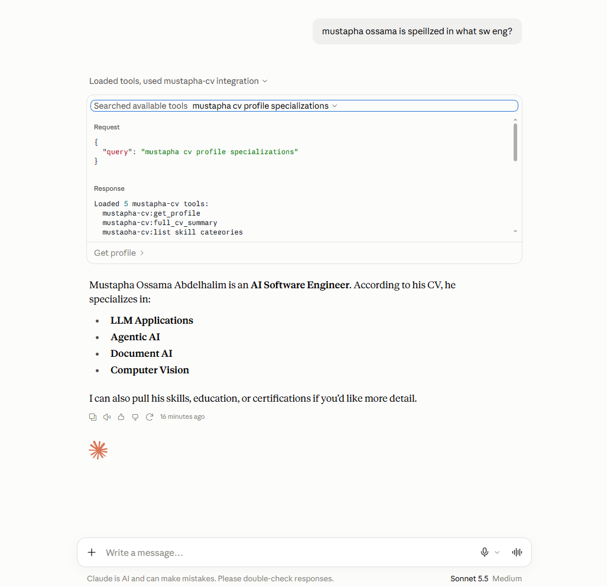
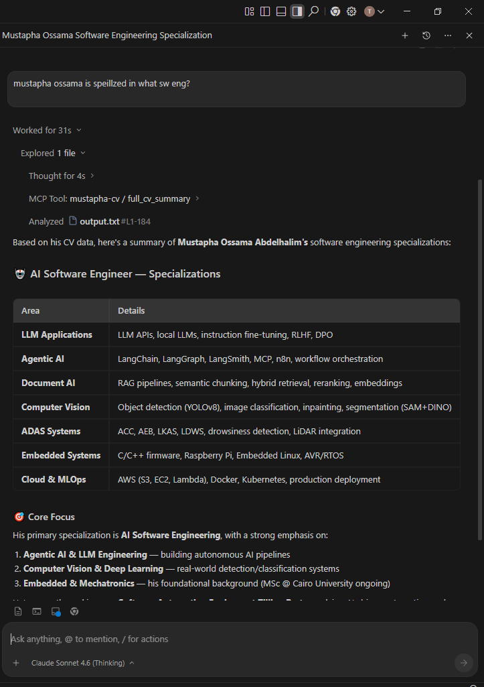

# MCP Tutorials

A collection of **Model Context Protocol (MCP)** tutorials and examples — from a local CV-serving MCP server to a full MCP client + server agent application.

---

## Repository Structure

```
MCP-tutorials/
├── local_mcp_server/          ← Standalone MCP server exposing a personal CV
│   ├── server.py              ← FastMCP server with 9 tools + 3 resources
│   ├── Claude_MCP_screenshoot.png
│   └── antigravity_MCP_screenshoot.png
│
└── MCP client and server/     ← Full MCP agent: ATS CV Reviewer
    ├── server.py              ← MCP Server (2 pluggable tools)
    ├── agent.py               ← MCP Client — LangGraph ReAct agent
    ├── gui.py                 ← Tkinter desktop GUI
    ├── tools/
    │   ├── read_cv_pdf.py     ← Tool 1: extract text from PDF
    │   └── score_cv.py        ← Tool 2: keyword-match ATS scoring
    ├── requirements.txt
    └── MCP_screenshoot.png
```

---

## Tutorial 1 — Local MCP Server (CV Server)

> **`local_mcp_server/server.py`**

A self-contained **FastMCP** server that exposes Mustapha Ossama's CV data as queryable MCP tools and resources. Designed to be connected to any MCP-compatible client (Claude Desktop, Antigravity IDE, etc.).

### Tools exposed

| Tool | Description |
|------|-------------|
| `get_profile` | Name, title, specializations, contact details |
| `list_skill_categories` | All high-level skill categories |
| `get_skills` | Skills per category (or all) |
| `search_skills` | Search a keyword across all skills |
| `get_experience` | Work history (filterable by company) |
| `get_projects` | Projects list (filterable by tech stack) |
| `get_education` | Degrees and qualifications |
| `get_certifications` | Certifications and achievements |
| `full_cv_summary` | Complete CV in a single call |

### Resources exposed

| Resource URI | Description |
|-------------|-------------|
| `cv://pdf/base64` | Raw CV PDF encoded as Base64 |
| `cv://pdf/info` | PDF filename, path, and size metadata |
| `cv://skills/{category}` | Templated resource for skills by category |

### Running

```bash
python local_mcp_server/server.py
```

---

## Tutorial 2 — MCP Client + Server: ATS CV Reviewer

> **`MCP client and server/`**

A complete **MCP agent application** that reviews CVs against a job description using:
- **FastMCP** for the server (pluggable tool architecture)
- **LangGraph ReAct** for the agent loop
- **Mistral:7b via Ollama** as the local LLM
- **Tkinter** for the desktop GUI

### Architecture

```
agent.py  (MCP Client — LangGraph ReAct)
   │
   │  spawns as subprocess (stdio transport)
   ▼
server.py (MCP Server)
   ├── Tool: read_cv_pdf   → extracts text from a PDF
   └── Tool: score_cv      → keyword-match score vs job description
```

The agent auto-discovers all tools registered in `server.py` — adding a new tool requires **zero changes** to `agent.py`.

### Prerequisites

1. **Python 3.11+**
2. **Ollama** with Mistral:7b:
   ```bash
   ollama pull mistral:7b
   ollama serve          # starts on http://localhost:11434
   ```

### Installation

```bash
pip install -r "MCP client and server/requirements.txt"
```

### Usage

```bash
python "MCP client and server/agent.py"
```

The Tkinter GUI will open. Browse for a CV PDF, enter a job description, and click **Review CV**.

### MCP Server Tools

| Tool | Args | Returns |
|------|------|---------|
| `read_cv_pdf` | `pdf_path: str` | Extracted CV text |
| `score_cv` | `cv_text: str`, `job_description: str` | JSON report with score & keywords |

### Adding a New Tool

1. Create `tools/<your_tool>.py` with a plain Python function
2. Import it in `server.py` and register with `mcp.tool()(your_function)`
3. Done — `agent.py` picks it up automatically

---

## Tech Stack

| Layer | Technology |
|-------|-----------|
| MCP Framework | [FastMCP](https://github.com/jlowin/fastmcp) (`mcp[cli]`) |
| LLM | Mistral:7b (via Ollama) |
| Agent | LangGraph ReAct |
| LLM Bridge | `langchain-mcp-adapters`, `langchain-ollama` |
| PDF Parsing | `pdfplumber` |
| GUI | Tkinter |

---

## Screenshots

| Claude Desktop | Antigravity IDE |
|---------------|-----------------|
|  |  |
